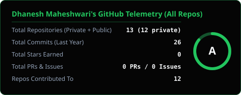
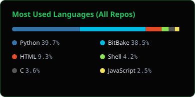
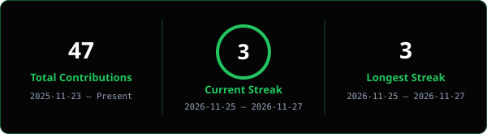

<div align="center">

<!-- Animated Hacker-Green Typing Header -->
<a href="https://github.com/dhanesh686-m">
  
</a>

<p>
  <a href="https://www.linkedin.com/in/dhanesh686-m/"></a>
  <a href="mailto:maheshwarid299@gmail.com"></a>
  <a href="https://github.com/dhanesh686-m/Portfolio"></a>
  
</p>

</div>

---

### `>_` Operator Profile

```yaml
operator: "Dhanesh Maheshwari"
location: "Bhiwadi, Rajasthan, India"
current_role: "Junior Engineer @ Allied Medical Limited (Jul 2026 - Present)"
focus:
  - "Offensive Security & Automated Penetration Testing"
  - "Embedded Linux (Yocto / Poky), Raspberry Pi 4 CM, Firefly ROC-RK3568-PC (Rockchip RK3568) & CAN-FD Systems"
  - "GUI Developer (Qt 6 / QML, PyQt / PySide) & Modern C++ (14 / 17 / 20 / 23)"
  - "Edge AI, Computer Vision (YOLOv8 / MediaPipe) & Cyber Digital Twins"
methodologies:
  - "V-Model (Medical Embedded)"
  - "Agile / Scrum (Full-Stack & Edge AI)"
  - "Iterative DevSecOps SDLC"
cloud_lab_stack: "Kaggle (GPU/TPU) -> INT8 ONNX -> Hugging Face Spaces"
```

---

### Technical Arsenal

<table>
  <tr>
    <td valign="top" width="50%">
      <h4>Cybersecurity &amp; Red/Blue Ops</h4>
      
      
      
      
      
      
    </td>
    <td valign="top" width="50%">
      <h4>Embedded Systems, C++ &amp; GUI</h4>
      
      
      
      
      
      
      
      
      
      
      
    </td>
  </tr>
  <tr>
    <td valign="top" width="50%">
      <h4>AI, Computer Vision &amp; RL</h4>
      
      
      
      
      
    </td>
    <td valign="top" width="50%">
      <h4>DevOps, Web &amp; Cloud</h4>
      
      
      
      
      
      
    </td>
  </tr>
  <tr>
    <td valign="top" width="50%">
      <h4>Tools, IDEs &amp; Infrastructure</h4>
      
      
      
      
      
      
      
      
      
      
      
      
      
    </td>
    <td valign="top" width="50%">
      <h4>Project Management &amp; Methodologies</h4>
      
      
      
      
      
    </td>
  </tr>
</table>

---

### Featured Systems &amp; Futuristic Lab Roadmap

| Project | Domain | Architecture &amp; Highlights | Status |
| :--- | :--- | :--- | :--- |
| **Anesthesia Workstation + Custom Yocto Image** | Medical Embedded | **V-Model:** Qt 6 / QML + C++ (14/17/20/23) touchscreen UI, live waveforms, CAN-FD transport, signed/encrypted GitLab Release OTA &amp; USB pendrive updates, QR read-only public-IP screen mirroring, QR/pendrive PDF export &amp; custom Yocto Linux (Firefly ROC-RK3568-PC / RK3568) | In Progress |
| **Custom Yocto OS &amp; Ventilator Flow Meter** | Embedded Linux | **V-Model:** Custom Yocto/Poky Linux images + Raspberry Pi 4 CM deployment for medical hardware | Production / Work |
| **Mechanical Rotary Encoder Input Driver** | Embedded Driver | **V-Model:** C/C++ Linux `evdev` kernel/user-space driver mapping right turn -> `Tab`, left turn -> `Shift+Tab`, click -> `Enter` for Qt 6 embedded UI navigation | Production / Work |
| **FlipperZero Clone (`AEGIS-RF`)** | Offensive / RF Sec | **Iterative DevSecOps:** Flask + SocketIO + Scapy + Bleak + BadUSB + Evil Portal *(upgrading with Kaggle RF Classifier)* | Active / Upgrading |
| **[AstraFlow](https://dhanesh686-m-astraflow.static.hf.space) (`AI Traffic + Hand Gesture`)** | CV + MARL | **Agile:** Kaggle PPO (`INT8 ONNX` via `onnxruntime-web`) + Three.js 3D Holo-Twin + MediaPipe Hands | [Live Demo](https://dhanesh686-m-astraflow.static.hf.space) |
| **[SKILL-FORGE AI](https://dhanesh686-m-skill-forge.static.hf.space) (`Job Board + ATS Suite`)** | Full-Stack / AI | **Agile / Scrum:** RBAC Candidate/Recruiter/Admin consoles + Semantic ATS Matcher + FastAPI OTP Auth (with Forgot Password) &amp; Event-Driven SMTP Mail Server | [Live Demo](https://dhanesh686-m-skill-forge.static.hf.space) |
| **Secure File Sharing (`ZK-STEGANO`)** | Cryptography | Flask + Fernet per-file keys + expiry limits *(upgrading to WebCrypto + Post-Quantum P2P)* | Active / Upgrading |
| **Automated Pen-Testing &amp; Recon Suite** | Cybersecurity | Python GUI automating Nmap, Nikto, Metasploit &amp; downloadable vulnerability reports | Completed |
| **Ghost-Firmware Lab (`N1`)** | Embedded Security | QEMU ARM64 + Virtual CAN-FD Bus + Transformer Syscall Anomaly Detector on HF Spaces | Roadmap |

---

### GitHub Telemetry

<div align="center">
  
  
</div>

<div align="center">
  
</div>
